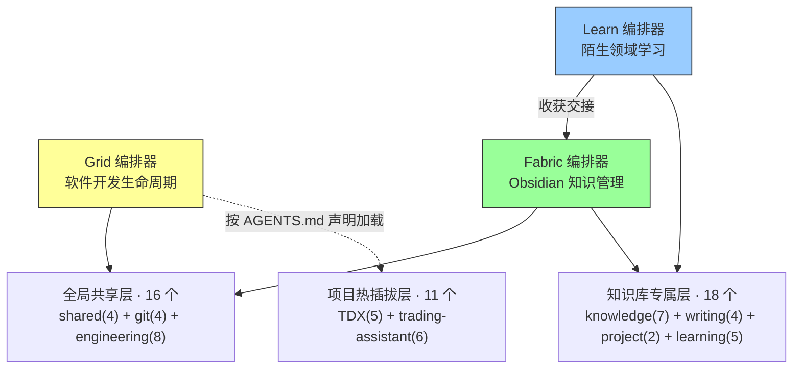
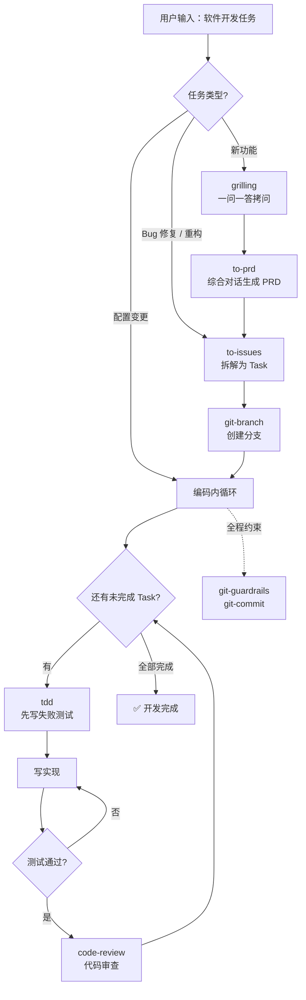
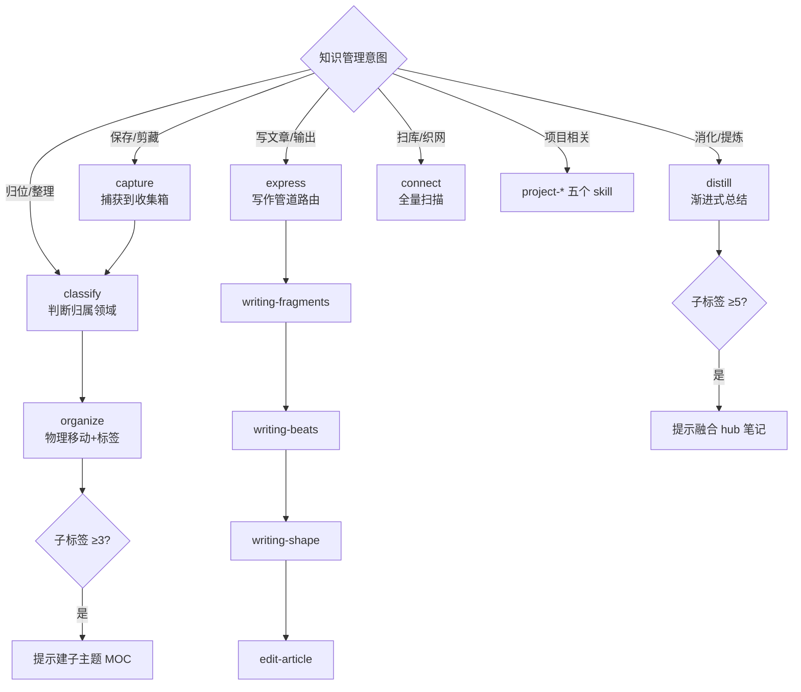
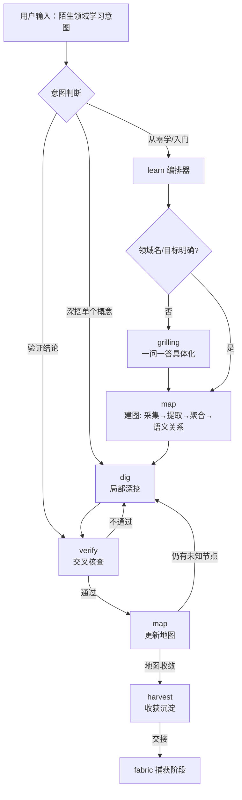

# skills

> 三线 Agent Skill 体系——45 个原子技能。这不是一份技能清单，而是一套方法论的沉淀：让 AI 助手在「软件开发生命周期」、「知识管理」与「陌生领域学习」三条工作流上，每次都以相同的过程工作。

**Agent Skill** 是写给 AI Agent 的指令包：一段触发描述 + 有序步骤 + 按需展开的参考。本仓库把这种指令包系统化为 45 个 skill + 35 个 reference 文件——围绕"让指令可预测"组织。

## 为什么要做

单条指令不难写，难的是让 Agent 在几十种任务上行为一致。这套体系诞生于三条长期工作流：

- **软件开发**：数据管道（Python + PostgreSQL）、WEB 全栈（NestJS + Prisma）
- **知识管理**：一个 Obsidian 库的剪藏、消化、织网、写作
- **陌生领域学习**：从零学习新领域——建图、深挖、验证、沉淀

没有体系时，规则只有两种命运：要么散落在各处被遗忘，要么膨胀成没人能读完的单体——曾经的 `note-workflow` 171 行、`git-operations` 325 行。Agent 每次运行都可能挑着遵守不同的子集，行为不稳定，token 在重复解释规则中浪费。

这套体系的目标只有一个：**从随机系统中拧出确定性**——每次运行采取相同的过程。这是所有设计的根源美德，定义见 [writing-great-skills](./shared/writing-great-skills/SKILL.md)。

## 从哪来

目标确定了，方法的起点是 Matt Pocock（TypeScript 教育家、开源 agent skills 作者）公开的 36 个 skills。2026 年 7 月逐份分析后，提取了 14 条可复用设计原则——原子化拆分、共享 primitive、编排器模式、用精确术语锚定行为（Leading Word）……

**为什么不直接用 Matt 原版？** 四个理由：

1. **编排器**：Matt 的 7 个主流程 skill 是松散管道，靠人手动串联；这里需要一个有状态的总调度器，按阶段路由、自动加载原子 skill
2. **中文环境**：所有 skill 用简体中文书写（Matt 原版为英文），与日常工作语言一致
3. **知识管理脊椎**：Matt 体系没有知识管理——Fabric 脊椎（捕获→提炼→织网）是全新设计
4. **项目热插拔**：项目专属技能按 `AGENTS.md` 声明注册，随项目装卸

于是有了「三线编排器」：**Grid**（软件开发生命周期）、**Fabric**（知识管理）与 **Learn**（陌生领域学习），各自是一个总**编排器**——有内部状态的总调度器，按阶段路由并驱动原子 skill。Learn 与 Fabric 构成流水线接力（Learn 管"内容到手前"的认知获取，收获后交接 Fabric 沉淀）。此外，被三条线共用的底层技能沉淀为**全局共享 primitive**。

演化线：

- **2026-07-15** v1.0.0：编制完成 40 个 skill，按 8 个功能域分组
- **2026-07-28** v1.0.1：体系自审与瘦身——理论深化 + 项目实例化配置
- **2026-08-06** v1.0.2：全量部署到运行时位置（全局 13 + 知识库 16 + 项目 11）
- **2026-08-15** v1.0.3：docs 与 skills 逐份核验同步
- **2026-08-17** v1.0.5：CHANGELOG 规范治理——新增 `changelog-guide` 校验守卫（42 个 skill）
- **2026-08-23** v1.0.7：新增 Learn 脊椎——陌生领域学习策略编排（47 个 skill）
- **2026-11-15** v2.0.0：编排器转可见 + 四态状态机 + 治理 skill（`setup-grid` / `retro`，49 个 skill）
- **2026-11-15** v2.1.0：按工作单元合并 git / project 域——git 6→4、project 5→2（44 个 skill）
- **2026-11-15** v2.2.0：新增 `implement` Task 执行 skill + 开发计划/文档骨架统一（45 个 skill）

沉淀下来的不是 45 个文件，而是一套从"分析别人的体系"到"演化出自己的体系"的方法。

## 能做什么

方法落地为 45 个 skill，按 9 个功能域组织，部署在三个层次：

三条工作流的流程线：

- **Grid**：`路由 → 拷问 → PRD → 拆Issue → 编码内循环 → 超大任务规划`
- **Fabric**：`捕获 → 分类 → 归位 → 提炼 → 输出 → 织网`
- **Learn**：`建图 → 深挖 → 验证 → 更新地图 → 收获（交接 Fabric）`

| 功能域 | 数量 | 职责 |
|--------|------|------|
| [shared](./shared/README.md) — 全局共享 primitive | 4 | Skill 元规范、一问一答拷问、红绿循环测试、8 目录文档骨架 |
| [git](./git/README.md) — Git 工程工具 | 4 | 危险命令拦截、提交与 CHANGELOG 治理、分支生命周期、推送 |
| [engineering](./engineering/README.md) — Grid 脊椎 | 8 | 总编排器 + PRD 综合、Issue 拆分、Task 执行、双轴代码审查、大型重构渐进规划、部署检查、会话复盘 |
| [knowledge](./knowledge/README.md) — Fabric 脊椎 | 7 | 捕获 → 分类 → 归位 → 提炼 → 输出 → 织网 |
| [learning](./learning/README.md) — Learn 脊椎 | 5 | 陌生领域学习：建图 → 深挖 → 验证 → 收获 → 交接 Fabric |
| [writing](./writing/README.md) — 写作体系 | 4 | 碎片采集 → 节拍编排 → 逐段塑形 → 逐段重写 |
| [project](./project/README.md) — 项目管理 | 2 | 生命周期（立项 → 计划 → 归档）、维护（回顾 + 链接） |
| [tdx](./tdx/README.md) — TDX 项目专属 | 5 | TdxQuant 文档、Loguru、Prisma 规范、10 步开发流程、集成测试 |
| [trading-assistant](./trading-assistant/README.md) — TA 项目专属 | 6 | NestJS 生成、Schema 同步、金融审查、契约校验、文档同步、测试 |

各域 README 内含每个 skill 的一句话职责。

项目专属两域采用**热插拔注册制**：项目在 `AGENTS.md` 中声明技能列表，Grid 在路由和编码阶段扫描声明、按任务类型动态推荐加载。

## 如何正确使用

对工具读者，以下是从安装到排障的完整路径。

### 三步上手

1. **安装**：`npx skills add Grid0723/skills`——全局安装对所有项目可用；在目标目录内安装则只对该项目（或本知识库）生效
2. **触发**：skill 按 `description 自动匹配 > 编排器路由 > 用户主动调用` 的优先级加载。Grid/Fabric/Learn 三个编排器**对模型可见**（不设 `disable-model-invocation`），由 description 的触发词自动加载；加载后按 `AGENTS.md` 6.2 先确认再执行
3. **开始**：现在就可以说「保存这个」、「帮我实现一个功能」或「我要学 X 领域」——编排器接管后，全程由它路由到正确的原子 skill

### 加载优先级

按部署层级加载：**全局 `~/.agents/skills/` > 知识库 `.agents/skills/` > 项目 `<项目>/.agents/skills/`**。全局 16 个随处可用；知识库专属 18 个只在 Obsidian 库内可用；项目专属 11 个只在对应项目目录内可用。

### Grid：软件工程任务的路由

### Fabric：知识管理任务的路由

归位和提炼完成后会自动检测子标签下笔记数——≥3 篇提示建子主题 MOC，≥5 篇提示融合 hub 笔记，不需要手动记住阈值。

### Learn：陌生领域学习任务的路由

Learn 与 Fabric 是流水线接力关系：Learn 管"内容到手前"的认知获取（建图→深挖→验证→更新地图循环），收获后产出写入 `00_收集箱` 交接 Fabric 沉淀（分类→归位→提炼→织网）。验证贯穿全程，防止"漂亮但不正确"的地图。

### 45 个 skill 分类矩阵

| 功能域 | 数量 | 部署层级 | 代表 skill |
|--------|------|---------|-----------|
| shared — 全局共享 primitive | 4 | 全局 `~/.agents/skills/` | writing-great-skills, grilling, tdd, doc-architecture |
| git — Git 工程工具 | 4 | 全局 | git-guardrails, git-commit, git-branch, git-push |
| engineering — Grid 脊椎 | 8 | 全局 | grid, to-prd, to-issues, implement, code-review, wayfinder, setup-grid, retro |
| knowledge — Fabric 脊椎 | 7 | 知识库 `.agents/skills/` | fabric, capture, classify, organize, distill, express, connect |
| learning — Learn 脊椎 | 5 | 知识库 `.agents/skills/` | learn, map, dig, verify, harvest |
| writing — 写作体系 | 4 | 知识库 | writing-fragments, writing-beats, writing-shape, edit-article |
| project — 项目管理 | 2 | 知识库 | project-lifecycle, project-maintain |
| tdx — TDX 项目专属 | 5 | TDX 项目 `.agents/skills/` | tdx-quant-docs, loguru, prisma-docs, tdx-dev-guide, tdx-test-spec |
| trading-assistant — TA 项目专属 | 6 | TA 项目 `.agents/skills/` | nest-generate, prisma-sync, finance-review, api-contract, doc-sync, ta-test-spec |

### 关键协作链路

| 场景 | 链路 |
|------|------|
| 新功能开发 | grid → grilling → to-prd → to-issues → git-branch → tdd → code-review → git-commit |
| 剪藏到消化 | fabric → capture → classify → organize → distill |
| 陌生领域学习 | learn → map → dig → verify → 更新地图（循环）→ harvest → 交接 fabric |
| 写一篇文章 | fabric → express → writing-fragments → writing-beats → writing-shape → edit-article |
| 项目收尾 | project-lifecycle（归档模式） → 提炼可复用知识反哺知识库 → 项目移入归档 |
| 织网检测 | organize 完成后检 ≥3 提示建 MOC；distill 完成后检 ≥5 提示融合 hub |

### 常见问题速答

- **skill 没被加载？** 先确认已部署（对应路径下有 `SKILL.md`）；再在对话中明确提及 skill 名或触发关键词。Grid/Fabric/Learn 需对话语义触发，不会被自动调用
- **多个 skill 同时匹配？** 编排器优先——先加载 Grid/Fabric/Learn，再由编排器路由到原子 skill
- **项目专属 skill 不生效？** 检查项目 `AGENTS.md` 的 `skills:` 声明，且当前工作目录必须在该项目内
- **如何确认 skill 生效？** 观察 `@available_skills` 列表中出现该 skill；加载后 Agent 会使用 skill 定义的精确术语

## 文档导航

- **[Grid Skills 使用手册](./docs/Grid%20Skills%20使用手册.md)** — 完整操作指南：路由决策图、45 个 skill 的触发条件速查、协作关系、故障排查
- **[CHANGELOG.md](./CHANGELOG.md)** — 版本变更记录（Keep a Changelog + SemVer）
- 各功能域职责速览见上方「能做什么」表格，每个域 README 含全部 skill 的一句话职责
