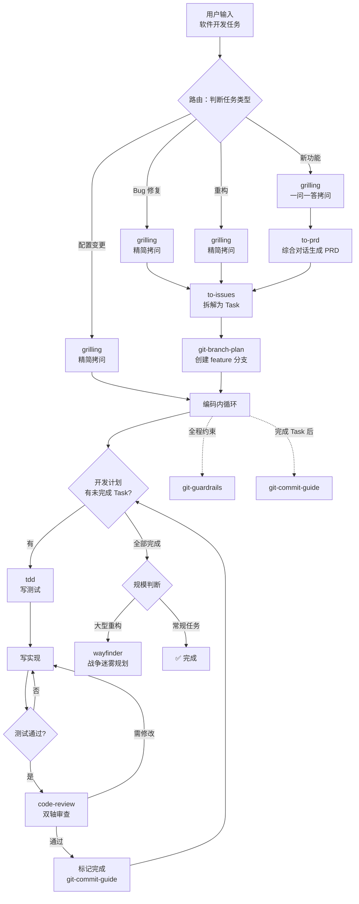
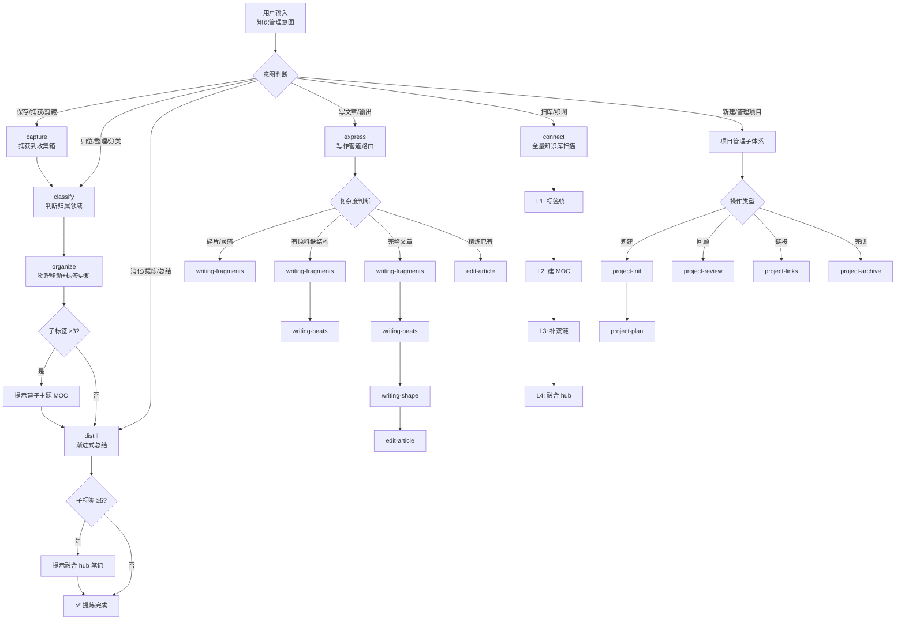
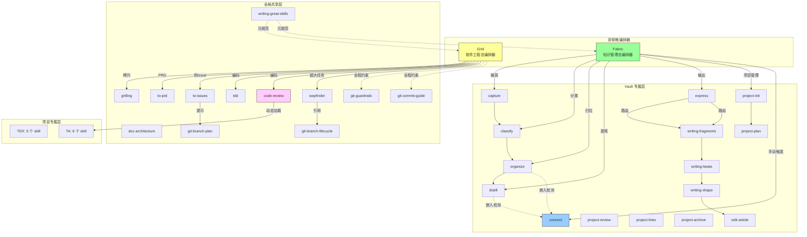

# Grid Skills 使用手册

> [!abstract]
> Grid0723/skills 体系包含 **42 个原子 skill**，按双脊椎编排器（Grid + Fabric）驱动工作流。本文档是操作级参考手册：前半部分以工作流为线索介绍编排器的路由决策，后半部分以 skill 为条目提供完整速查。

## 一、总览

### 42 个 Skill 分类矩阵

| 功能域                             | 数量  | 部署层级                    | 典型 skill                                                                         |
| ------------------------------- | --- | ----------------------- | -------------------------------------------------------------------------------- |
| **shared** — 全局共享 primitive     | 4   | 全局 `~/.agents/skills/`  | writing-great-skills, grilling, tdd, doc-architecture                            |
| **git** — Git 工程工具              | 6   | 全局 `~/.agents/skills/`  | git-guardrails, git-commit-guide, git-branch-plan, git-branch-lifecycle, git-push-guide, changelog-guide |
| **engineering** — Grid 脊椎       | 5   | 全局 `~/.agents/skills/`  | grid, to-prd, to-issues, code-review, wayfinder                                  |
| **knowledge** — Fabric 脊椎       | 7   | Vault `.agents/skills/` | fabric, capture, classify, organize, distill, express, connect                   |
| **writing** — 写作体系              | 4   | Vault `.agents/skills/` | writing-fragments, writing-beats, writing-shape, edit-article                    |
| **project** — 项目管理              | 5   | Vault `.agents/skills/` | project-init, project-plan, project-review, project-links, project-archive       |
| **tdx** — TDX 项目专属              | 5   | TDX `.agents/skills/`   | tdx-quant-docs, loguru, prisma-docs, tdx-dev-guide, tdx-test-spec                |
| **trading-assistant** — TA 项目专属 | 6   | TA `.agents/skills/`    | nest-generate, prisma-sync, finance-review, api-contract, doc-sync, ta-test-spec |

### Skill 加载优先级

```bash
description 自动匹配 > 编排器路由加载 > 用户主动调用
全局 skill（~/.agents/） > Vault skill（.agents/） > 项目 skill（<项目>/.agents/）
```

1. **description 自动触发**：Agent 根据用户输入语义匹配各 skill 的 `description` 字段，自动加载
2. **编排器路由**：Grid/Fabric 总编排器判断任务类型，按阶段显式加载对应原子 skill
3. **用户主动调用**：通过 `/skill` 或对话中明确提及 skill 名来加载

---

## 二、Grid 编排器——软件工程线

> Grid 是软件开发生命周期的总编排器。加载条件：用户提出软件开发任务（"帮我实现"、"写代码"、"改 bug"）。

### 路由决策流程



### 各阶段详解

| 阶段 | 加载的 skill | 触发条件 | 产出物 |
|------|-------------|---------|--------|
| **路由** | — | 接收用户输入后立即执行 | 判定任务类型 + 推荐阶段序列 + 推荐项目 skill |
| **拷问** | `grilling` | 任务模糊需要具体化 | 共识（无文件产出） |
| **PRD** | `to-prd` | 新功能（Bug 修复/重构/配置变更跳过） | `docs/01-Requirements/PRD-xxx.md` |
| **拆 Issue** | `to-issues` → `git-branch-plan` | PRD 完成后（配置变更跳过） | `docs/07-MVP/开发计划.md` + feature 分支 |
| **编码内循环** | `tdd` → `code-review` → `git-commit-guide` | 逐 Task 推进 | 代码 + 测试 + `docs/05-ADR/` 审查报告 |
| **超大任务规划** | `wayfinder` → `git-branch-lifecycle` | 仅 DevOps 级大型重构/迁移 | 共享地图 + Ticket 列表 |

### 项目技能热插拔扫描

Grid 在路由和编码阶段自动扫描当前项目 `AGENTS.md` 中的 `skills:` 声明：

- **TDX 项目**：自动推荐 `tdx-quant-docs`、`tdx-dev-guide`、`loguru`、`tdx-test-spec`、`prisma-docs`
- **trading-assistant 项目**：自动推荐 `nest-generate`、`prisma-sync`、`finance-review`、`api-contract`、`doc-sync`、`ta-test-spec`

### 编码内循环详解

```bash
未完成 Task
  → tdd（先写失败测试）
    → 写最小实现
      → 测试通过？
        → 否：回到实现
        → 是：code-review（双轴并行审查）
          → Standards 审查（加载项目专属审查 skill）
          → Spec 审查（独立上下文）
          → 通过：标记 -[x]，git-commit-guide 提交
          → 需修改：回到实现
```

### 全局约束

编码阶段全程自动遵守：
- `git-guardrails` — 禁止未经确认执行 `git add/commit/push`
- `git-commit-guide` — 一个 commit 只做一件事，小步快跑
- `git-branch-lifecycle` — 长周期分支定期同步、冲突预防

---

## 三、Fabric 编排器——知识管理线

> Fabric 是 Obsidian Vault 知识管理的总编排器。加载条件：用户要求管理笔记（"保存这个"、"消化这篇"、"整理知识库"、"写文章"）。

### 路由决策流程



### 六阶段详解

| 阶段 | 加载的 skill | 触发条件 | 产出物 |
|------|-------------|---------|--------|
| **捕获** | `capture` | 用户提供 URL/灵感/剪藏 | `00_收集箱/` 笔记，`状态: 待整理` |
| **分类** | `classify` | 收集箱有待整理笔记 | 归属方向确认（对照 9 领域表） |
| **归位** | `organize` | 分类确认后 | 文件移入领域/项目目录，frontmatter 更新 |
| **提炼** | `distill` | 归位后需要深化 | 四层渐进式总结（加粗→高亮→执行摘要） |
| **输出** | `express` → 写作管道 | 需要将笔记转化为文章 | 按复杂度路由到写作体系 |
| **织网** | `connect` | 用户主动要求全量扫描 | MOC/hub/双链建议列表 |

### 织网嵌入检测

Fabric 在两个阶段自动嵌入织网检测：

1. **归位完成后**：查询该笔记关联子标签下笔记数 ≥3 → 提示建子主题 MOC（`类型: 索引`）
2. **提炼完成后**：查询子标签 ≥5 → 提示融合为整合 hub 笔记（`状态: 可输出`）

### 写作管道路由

`express` 根据用户意图判断复杂度，路由到写作体系：

| 用户意图 | 管道 | 说明 |
|---------|------|------|
| 碎片/灵感 | `writing-fragments` | 追问式访谈，碎片化采集原料 |
| 有原料缺结构 | `fragments` → `beats` | 采集后进入节拍编排 |
| 完整文章 | `fragments` → `beats` → `shape` → `edit-article` | 完整 Explore→Exploit 管道 |
| 精炼已有 | `edit-article` | DAG 依赖顺序逐段重写 |

### 项目管理子体系

5 个项目管理 skill 独立于 CODE 阶段管道，通过 Fabric 按需触发：

| 用户说 | 加载 skill | 说明 |
|--------|-----------|------|
| "新建项目" | `project-init` → `project-plan` | 总览文档 + 任务清单 |
| "更新里程碑"、"回顾进度" | `project-review` | 基于 CHANGELOG/commit log |
| "加个外部链接" | `project-links` | `20_项目/外部链接.md` |
| "归档项目" | `project-archive` | 先反哺知识到 `10_领域`，再移入 `90_归档` |

---

## 四、全局 Skill 速查

> 部署于 `~/.agents/skills/`，对任意 OpenCode 项目可用。共 14 个。

### 4.1 全局共享 primitive（shared）

#### writing-great-skills

- **功能**：编写 Skill 的元规范——四轴领域模型（调用轴/信息层级轴/引导轴/裁剪轴）+ 本体系专属约定
- **触发**：编写新 skill、修改现有 skill、审查 skill 质量
- **输入**：skill 设计意图或现有 SKILL.md
- **输出**：符合规范的 skill 文件
- **协作**：作为元规范被所有 skill 引用，含 GLOSSARY.md 术语表
- **特殊**：写任何 skill 之前必读

#### grilling

- **功能**：一对一接力式面试——每次一个问题，把模糊想法具体化
- **触发**：需求模糊、需要确认设计决策、Grid 拷问阶段
- **输入**：上下文（代码/文档/对话历史）
- **输出**：共识（无文件产出）
- **协作**：被 Grid 编排器在拷问阶段加载；≥3 轮不收敛则建议跳 PRD
- **参考**：references/examples.md — 4 个完整交互场景

#### tdd

- **功能**：红绿循环测试标准——接缝驱动，先写失败测试、最小实现、重构清理
- **触发**：编写测试、实现新功能、审查测试质量、Grid 编码内循环
- **输入**：功能描述或 seam 定义
- **输出**：测试代码 + 实现代码
- **协作**：被 Grid 编码阶段加载；需要测试规范的项目 skill（tdx-test-spec/ta-test-spec）提供项目级实施规范
- **参考**：references/mocking.md、references/tests.md

#### doc-architecture

- **功能**：项目文档的标准 8 目录骨架——每目录撰写规范、Grid 阶段产出映射
- **触发**：新项目初始化、文档重构、Grid 各阶段的产出路径参考
- **输入**：项目类型
- **输出**：文档目录结构 + 10 个空白模板 + 项目实例化配置
- **协作**：为 Grid 各阶段提供产出路径规范；prisma-sync/doc-sync 依赖其目录定义
- **特殊**：含 TDX 和 TA 项目的实例化配置

### 4.2 Git 工程工具（git）

#### git-guardrails

- **功能**：拦截危险的 Git 命令，防止不可逆破坏
- **触发**：任何涉及 Git 操作的对话（自动生效）
- **输入**：待执行的 Git 命令
- **输出**：安全审批——展示影响范围，确认后执行
- **协作**：被 Grid 编码阶段作为全局约束加载

#### git-commit-guide

- **功能**：通用提交原则——一个 commit 只做一件事，小步快跑
- **触发**：编码完成一个功能点、Grid 编码内循环标记 Task 完成后
- **输入**：待提交的变更
- **输出**：格式化的 commit message（前缀格式由项目 AGENTS.md 声明）
- **协作**：被 Grid 编码阶段引用

#### git-branch-plan

- **功能**：拆解任务后规划分支命名和创建策略——短命分支、从最新 main 拉出
- **触发**：Grid to-issues 完成后、新 feature 开始前
- **输入**：开发计划中的 Task 列表
- **输出**：分支命名 + 创建命令
- **协作**：被 Grid 拆 Issue 阶段自动提示

#### git-branch-lifecycle

- **功能**：长周期分支管理——定期同步、冲突预防、合并策略选择
- **触发**：分支存活超 2 天、准备合并长周期分支
- **输入**：当前分支状态
- **输出**：同步策略 + 合并建议
- **协作**：被 Grid wayfinder 阶段引用

#### git-push-guide

- **功能**：推送原则——推前自检门、领先/落后检测、失败处理、发布 tag 推送
- **触发**：即将 push、询问推送方法、push 失败或被拒、发布版本打 tag
- **输入**：当前仓库与分支状态
- **输出**：推前检查结论 + 推送命令或失败修复方案
- **协作**：被 Grid 编码内循环引用；危险命令移交 git-guardrails

#### changelog-guide

- **功能**：CHANGELOG 格式校验守卫——六种变动类型、Unreleased 区块、SemVer 版本递增、ISO 8601 日期
- **触发**：创建或编辑 CHANGELOG 文件（全程自动背景校验）
- **输入**：待写入的 CHANGELOG 内容
- **输出**：格式合规校验 + 版本号递增建议（联动 git-commit-guide 提交类型）
- **协作**：doc-architecture 提供空白模板；doc-sync 决定何时同步；git-commit-guide 映射提交类型到版本号

### 4.3 Grid 脊椎（engineering）

#### grid

- **功能**：软件开发生命周期总编排器——路由→拷问→PRD→拆Issue→编码→超大任务规划
- **触发**：**用户提出软件开发任务**（"帮我实现"、"写代码"、"改 bug"）
- **输入**：用户需求描述
- **输出**：完整的开发流程推进 + 各阶段产出物
- **协作**：编排全局共享层 + 项目专属 skill；详见 [[Grid编排器设计]]
- **特殊**：`disable-model-invocation: true` — 仅由对话语义触发，不被模型自动调用

#### to-prd

- **功能**：将当前对话综合为 PRD 文档——不采访用户，纯综合已有讨论
- **触发**：grilling 阶段完成、用户表示"可以了"、Grid 的 PRD 阶段
- **输入**：对话历史中的共识
- **输出**：`docs/01-Requirements/PRD-xxx.md`
- **协作**：被 Grid 的 PRD 阶段加载
- **参考**：references/prd-template.md

#### to-issues

- **功能**：PRD 拆为 Tracer bullet 垂直切片——每个切片贯穿所有层，可独立演示
- **触发**：PRD 审批通过后
- **输入**：PRD 文档
- **输出**：`docs/07-MVP/开发计划.md`（含 `- [ ] Task-N: <描述> — 验证: <如何确认完成>` 任务清单）
- **协作**：被 Grid 拆 Issue 阶段加载；完成后自动提示 `git-branch-plan`
- **参考**：references/tracer-bullet-examples.md

#### code-review

- **功能**：双轴并行代码审查——Standards 审查 + Spec 审查，独立 sub-agent 上下文，报告不合并
- **触发**：开发计划中 Task 完成、合并前、PR review 时
- **输入**：已完成 Task 的代码变更
- **输出**：Standards 审查报告 + Spec 审查报告 → `docs/05-ADR/`
- **协作**：被 Grid 编码内循环加载；Standards 审查动态加载项目专属审查 skill（finance-review/api-contract）
- **参考**：references/review-templates.md

#### wayfinder

- **功能**：DevOps 类大型重构的战争迷雾规划——每 session 一个 ticket，解决后视野扩大
- **触发**：大型重构/迁移任务（如 pandas→Polars、PostgreSQL→TimescaleDB）
- **输入**：迁移目标描述
- **输出**：共享地图 + Ticket 列表（research/prototype/grilling/task 四种类型）
- **协作**：被 Grid 超大任务规划阶段加载；与 `git-branch-lifecycle` 协作
- **参考**：references/ticket-map-examples.md

---

## 五、Vault 专属 Skill 速查

> 部署于 `.agents/skills/`，仅在本 Obsidian Vault 中可用。共 16 个。

### 5.1 Fabric 脊椎（knowledge）

#### fabric

- **功能**：知识管理总编排器——管辖 Obsidian vault 内全部内容操作
- **触发**：**用户要求管理笔记**（"保存这个"、"消化这篇"、"整理知识库"、"写文章"）
- **输入**：用户操作意图
- **输出**：按 CODE 流程驱动原子 skill + 嵌入织网检测
- **协作**：编排 knowledge + writing + project 三个功能域；详见 [[Fabric编排器设计]]
- **特殊**：`disable-model-invocation: true` — 仅由对话语义触发

#### capture

- **功能**：将外部内容（URL/灵感/剪藏）捕获到 Obsidian 收集箱——捕获不加判断、不求全
- **触发**：用户提供 URL、分享想法、发送剪藏消息
- **输入**：URL 或文本内容
- **输出**：`00_收集箱/` 笔记，`状态: 待整理`
- **协作**：被 Fabric 捕获阶段加载
- **参考**：references/templates.md

#### classify

- **功能**：判断待整理笔记的归属领域/项目——文件夹定位置，标签管主题
- **触发**：收集箱有待整理笔记、分类任务
- **输入**：笔记内容 + frontmatter
- **输出**：归属方向（对照 9 领域表，不确定的标 `待归类/`）
- **协作**：被 Fabric 分类阶段加载
- **参考**：references/domain-table.md

#### organize

- **功能**：将已分类笔记物理移动到领域/项目目录，更新标签和状态
- **触发**：classify 确认归属后
- **输入**：笔记文件路径 + 分类结果
- **输出**：文件已移入目标目录，frontmatter 已更新，`状态: 已消化`
- **协作**：被 Fabric 归位阶段加载；完成后嵌入织网检测（子标签 ≥3 提示建 MOC）
- **参考**：references/organize-examples.md

#### distill

- **功能**：渐进式总结提炼——四层递进：加粗关键→高亮金句→写执行摘要
- **触发**：笔记归位后需要深化理解
- **输入**：已归位笔记
- **输出**：加粗 + 高亮 + 执行摘要的四层提炼版
- **协作**：被 Fabric 提炼阶段加载；完成后嵌入融合检测（子标签 ≥5 提示融合 hub）
- **参考**：references/distill-examples.md

#### express

- **功能**：Fabric 输出阶段——路由到写作体系（fragments→beats→shape→edit-article）
- **触发**：用户想"写文章"或从提炼后的笔记输出
- **输入**：写作意图 + 原料（笔记/碎片）
- **输出**：写作管道路由 + 第一个写作 skill 已加载
- **协作**：被 Fabric 输出阶段加载；路由到 writing 体系的 4 个 skill
- **不承担**：开启新项目（项目初始化走 project-init）
- **参考**：references/pipeline-routing.md

#### connect

- **功能**：手动全量扫描知识库——找出所有该建 MOC 或融合 hub 的地方
- **触发**：用户说"扫一下整个知识库"、"帮我织网"、"建 MOC"
- **输入**：整个 Vault
- **输出**：L1-L4 检查报告（标签统一→建 MOC→补双链→融合 hub）
- **协作**：被 Fabric 织网阶段加载（仅手动触发）

### 5.2 写作体系（writing）

#### writing-fragments

- **功能**：Explore 阶段——追问式访谈，碎片化采集写作原料
- **触发**：用户想"写文章但没有原料"、有想法需要探索
- **输入**：模糊主题
- **输出**：碎片化原料（命名隐喻、故事、观点片段）
- **协作**：被 Fabric express 路由；为 writing-beats 提供原料
- **参考**：references/question-templates.md

#### writing-beats

- **功能**：Exploit 阶段——将碎片原料组装为节拍旅程，使用 Grounding 机制确保概念无"跳读"
- **触发**：writing-fragments 完成后或"有原料缺结构"
- **输入**：碎片原料
- **输出**：节拍序列（维护"已接地清单"）
- **协作**：接收 writing-fragments 输出，为 writing-shape 提供节拍结构
- **参考**：references/grounding-example.md

#### writing-shape

- **功能**：Exploit 阶段——将节拍序列逐段塑形为完整文章
- **触发**：writing-beats 完成后
- **输入**：节拍序列
- **输出**：完整文章（每段落加衔接桥，继续 Grounding 验证）
- **协作**：接收 writing-beats 输出，为 edit-article 提供初稿
- **参考**：references/shape-examples.md

#### edit-article

- **功能**：Exploit 阶段——按 H2 标题拆分，构建 DAG 依赖图，逐段重写
- **触发**：已有完整文章需要打磨
- **输入**：完整文章
- **输出**：打磨后的文章（先编辑依赖最少的段落）
- **协作**：接收 writing-shape 输出，完成写作管道
- **参考**：references/edit-examples.md

### 5.3 项目管理（project）

#### project-init

- **功能**：在 `20_项目/` 下创建新项目的总览文档和外部链接文档
- **触发**：用户说"新建项目"、"开个新项目"
- **输入**：项目名称、领域标签
- **输出**：`20_项目/<项目名>/` 总览文档（`类型: 项目` + `项目阶段: 启动`）
- **协作**：完成后建议调用 `project-plan`；可被 Fabric 挂靠触发
- **参考**：references/templates.md

#### project-plan

- **功能**：按功能模块分组创建项目任务清单
- **触发**：project-init 完成后或需要更新项目范围
- **输入**：项目目标
- **输出**：`20_项目/<项目名>/项目计划.md` —— `- [ ] #项目/<名>` 格式任务清单
- **协作**：紧随 project-init 调用
- **参考**：references/plan-template.md

#### project-review

- **功能**：基于 CHANGELOG/commit log 更新项目的里程碑总结
- **触发**：完成关键功能、切换项目阶段、需要进度回顾
- **输入**：CHANGELOG 或 commit log
- **输出**：更新总览文档的「里程碑总结」——核心变更、关键决策、所学经验
- **协作**：被 Fabric 项目管理触发
- **参考**：references/review-template.md

#### project-links

- **功能**：维护项目的外部链接文档——`file:///` 本地路径和外部 URL
- **触发**：新增外部资源、更新链接、整理项目引用
- **输入**：链接信息
- **输出**：`20_项目/<项目名>/外部链接.md` + 更新 `20_项目/外部链接.md`
- **协作**：被 Fabric 项目管理触发

#### project-archive

- **功能**：项目完成后知识反哺 `10_领域`，再移入 `90_归档`
- **触发**：项目完成或不再活跃时
- **输入**：项目目录
- **输出**：提炼后的知识笔记 + 项目文件移入归档目录
- **协作**：被 Fabric 项目管理触发；先提炼再归档——归档后就很少再访问
- **参考**：references/archive-checklist.md

---

## 六、项目热插拔 Skill 速查

### 6.1 TDX 项目专属（5 个）

> 部署于 `D:\Documents\05code\TDX\.agents\skills\`。Python + PostgreSQL + TdxQuant 技术栈。

#### tdx-quant-docs

- **功能**：通达信 TdxQuant 量化框架 API 文档查阅——行情/K线/财务数据/选股公式/交易下单/回测等
- **触发**：涉及 TdxQuant API 调用、通达信数据获取、通达信公式计算
- **输入**：API 函数名或场景描述
- **输出**：返回值类型、参数约束、场景示例
- **特殊**：含 reference/ 下 15 个分类子目录 + 3 个根级综合文档，覆盖 60+ API

#### loguru

- **功能**：Loguru 日志库的配置指南——全局单例 logger、sink 注册、轮转/格式化
- **触发**：配置日志、调试日志输出、异常捕获
- **输入**：日志需求描述
- **输出**：配置代码 + 场景配方
- **参考**：references/api.md、references/patterns.md

#### prisma-docs

- **功能**：TDX 项目 Prisma ORM 操作规范——Schema 设计约定、Python 查询/写入、安全红线
- **触发**：TDX 项目中的数据库操作、Schema 变更
- **输入**：数据库操作需求
- **输出**：Prisma 代码（Python 客户端，`DECIMAL(36,18)`、`batch_upsert` 模式）
- **特殊**：安全红线——禁止自动执行危险命令

#### tdx-dev-guide

- **功能**：新增数据获取器的 10 步端到端开发流程——Cleaner→Fetcher 流水线 + 注册制
- **触发**：需要为 TDX 添加新的数据获取器
- **输入**：API 文档或数据源描述
- **输出**：完整的开发计划——从 API 分析到 CLI 注册

#### tdx-test-spec

- **功能**：TDX 项目集成测试规范——CLI 验收 + dry_run 先行 + 全链路验证
- **触发**：TDX 项目的测试编写、CI/CD 验证
- **输入**：待测试的获取器或数据管道
- **输出**：测试代码 + 验证策略（CLI→预览→写入→增量验证）

### 6.2 trading-assistant 项目专属（6 个）

> 部署于 `D:\Documents\05code\trading_assistant\.agents\skills\`。NestJS + Prisma + TypeScript 全栈。

#### nest-generate

- **功能**：按项目规范生成 NestJS 模块/控制器/服务/DTO
- **触发**：需要新建 NestJS 模块、创建 CRUD 端点、新增 DTO
- **输入**：模块名称 + 字段定义
- **输出**：NestJS 代码（NodeNext 模块系统 + DTO 验证栈 + 金额字符串传输）

#### prisma-sync

- **功能**：双份 Prisma Schema 同步——SSOT 设计稿（`docs/03-Database/`）↔ 实现稿（`backend/prisma/`）
- **触发**：修改数据模型、Schema 变更
- **输入**：Schema 变更描述
- **输出**：两份 Schema 同步（只同步 model/enum，不碰 datasource/generator）

#### finance-review

- **功能**：金融计算审查——decimal.js 审计，禁止原生浮点运算
- **触发**：涉及金额/价格/数量运算的代码提交
- **输入**：代码变更中的金融计算逻辑
- **输出**：审计报告——扫描 `+ - * /` 在变量运算上下文中的出现
- **协作**：被 `code-review` 的 Standards 审查 agent 动态加载

#### api-contract

- **功能**：OpenAPI 3.0 契约校验——后端 Controller + 前端 API 调用双端独立检查
- **触发**：修改 API 接口、前后端联调前
- **输入**：代码变更 + OpenAPI 契约文件
- **输出**：契约校验报告（路径/参数/响应/金额/分页五维度）
- **协作**：被 `code-review` 的 Standards 审查 agent 动态加载

#### doc-sync

- **功能**：代码变更后同步更新 `docs/` 文档和 CHANGELOG——文档驱动开发
- **触发**：代码变更完成
- **输入**：git diff
- **输出**：按变更类型（数据模型/API/架构/部署等）对应应更新的文档列表

#### ta-test-spec

- **功能**：trading_assistant 项目测试规范——lint 门 + test 门 + 类型守卫
- **触发**：TA 项目的测试编写、提交前检查
- **输入**：待测试的代码
- **输出**：测试代码（Mock PrismaService、decimal.js 断言、禁止 any）

---

## 七、Skill 间协作关系



### 关键协作链路

| 链路 | 触发场景 | 涉及 skill |
|------|---------|-----------|
| **新功能开发全链路** | 用户："帮我实现 ETF 数据获取" | grid → grilling → to-prd → to-issues → git-branch-plan → tdd → code-review → git-commit-guide |
| **code-review 动态子加载** | 编码 Task 完成 | code-review → finance-review + api-contract（仅 TA 项目） |
| **剪藏消化输出链路** | 用户："消化这篇微信文章" | fabric → capture → classify → organize → distill |
| **写作管道路由** | 用户："帮我写一篇关于…的文章" | fabric → express → writing-fragments → beats → shape → edit-article |
| **项目收尾全链路** | 项目完成 | project-archive → fabric（反哺知识） → 归档 |
| **织网检测链路** | organize/distill 完成后 | organize → 检≥3→connect 提示；distill → 检≥5→connect 提示 |

---

## 八、故障排查

### Skill 未被加载

> [!bug] 现象：期望加载的 skill 没有出现

**排查步骤**：

1. **确认 skill 已部署**：用 [[部署手册#五、验证清单|验证清单]] 检查对应路径下是否有 `SKILL.md`
2. **检查 description 匹配**：skill 的 `description` 字段是否对应你的输入语义——尝试在对话中明确提及 skill 名或其触发关键词
3. **检查 disable-model-invocation**：`grid` 和 `fabric` 设置了 `disable-model-invocation: true`，不会被模型自动调用——需要通过对话语义触发
4. **检查部署层级**：Vault 专属 skill 在 TDX/TA 项目中不可用；全局 skill 在所有项目中可用

### 多个 Skill 描述冲突

> [!warning] 现象：多个 skill 的 description 同时匹配用户输入

**处理**：
- 编排器 skill（grid/fabric）优先级最高——先加载编排器，再由编排器路由到原子 skill
- 同一层次无编排器时，Agent 会根据 context 长度和相关性自动选择最匹配的

### 验证 Skill 是否生效

1. **观察 `@available_skills` 列表**：skill 目录下有合法 `SKILL.md` 即会出现在列表中
2. **检查 skill 是否在对话中被加载**：对话中提及触发关键词，观察 Agent 行为是否切换为 skill 定义的流程
3. **查看 skill 的 Leading Words 是否被使用**：skill 加载后，Agent 会使用 skill 中定义的精确术语

### 项目专属 Skill 不加载

1. **确认 `AGENTS.md` 声明**：项目根目录 `AGENTS.md` 的 `skills:` 列表中是否包含了该 skill
2. **确认工作目录**：OpenCode 当前工作目录必须是该项目目录——在 vault 下开发 TDX 项目时，需要手动切换到 TDX 项目目录
3. **确认所属项目**：TDX skill 只在 TDX 项目可用，TA skill 只在 TA 项目可用

---

## 相关笔记

- [[部署手册]] — 42 个 skill 的部署路径与验证清单
- [[双脊椎Agent Skill体系设计]] — 架构总纲与设计原则
- [[Grid编排器设计]] — Grid 阶段序列与内循环详解
- [[Fabric编排器设计]] — Fabric CODE 阶段与织网机制
- [[Skill体系物理布局设计]] — 三层物理部署结构
- [[Grid与Matt Skills对照表]] — 与 Matt Pocock 体系的逐项对照
- [[CHANGELOG]] — 体系演化记录
