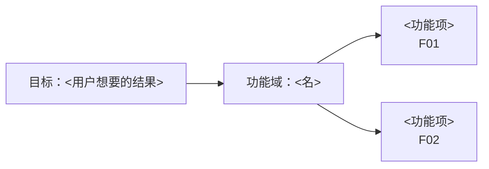

# PRD-F<nn>: <功能名>

> 命名：`PRD-F<nn>-<功能名>.md`（如 `PRD-F02-编辑菜单.md`）；`F<nn>` 与 `to-issues` 的功能编号一致。

## 目标

一句话描述要解决的问题。

## 功能域（可选 · 功能域 ≥3 时填）

> 三层固定：用户目标 → 功能域 → 功能项；功能域 3–7 个，功能项 ≤12。`F<nn>` 必须与 `07-MVP/开发计划.md` 一一对应。生成方法见 `doc-architecture` 的 `references/views/03-功能架构.md`。

## 范围

### 包含

- …

### 不包含

- …

## 接缝（可独立验证点）

- [ ] Seam 1: …
- [ ] Seam 2: …

## 约束

- 技术约束
- 时间约束（如有）

## 风险

- …
