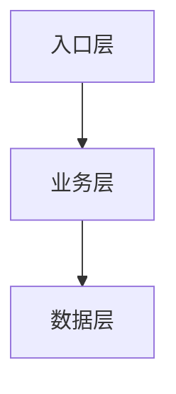
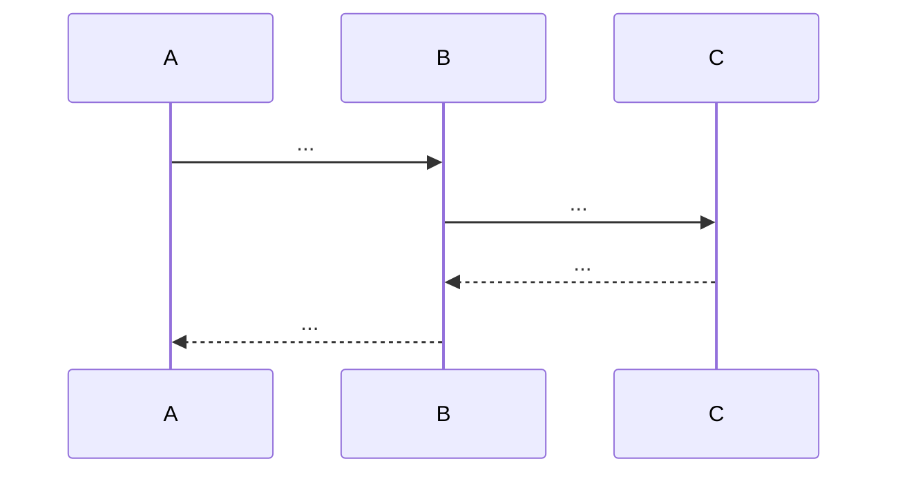

# 系统架构

## 概述

<项目一句话描述>

## 技术栈

| 组件 | 选型 | 版本 |
|------|------|------|
| 语言 | … | … |
| 框架 | … | … |
| 数据库 | … | … |

## 模块架构



## 目录结构

```bash
src/
├── <模块>/  # 职责
└── ...
```

## 核心数据流



## 关键设计原则

- …
- …

## 模块职责

| 模块 | 职责 | 核心类/函数 |
|------|------|-----------|
| … | … | … |
