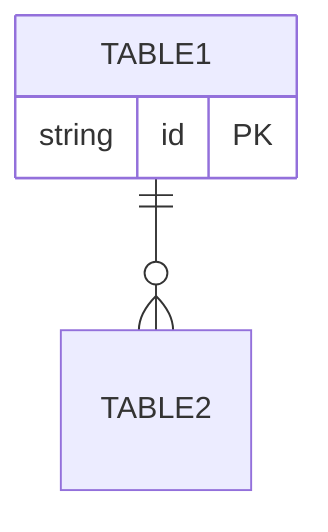

# 数据库设计

## ER 图

## 表结构总览

| 表名 | 说明 | 预估行数 |
|------|------|---------|
| … | … | … |

## 各表设计要点

### table_name

| 字段 | 类型 | 说明 | 约束 |
|------|------|------|------|
| id | string | 主键 | PK |
| … | … | … | … |

**主键**: (…)
**索引**: (…)
**更新策略**: upsert / insert-only / append

## 索引汇总

| 表 | 索引名 | 字段 | 类型 |
|----|-------|------|------|
| … | … | … | unique/btree |
