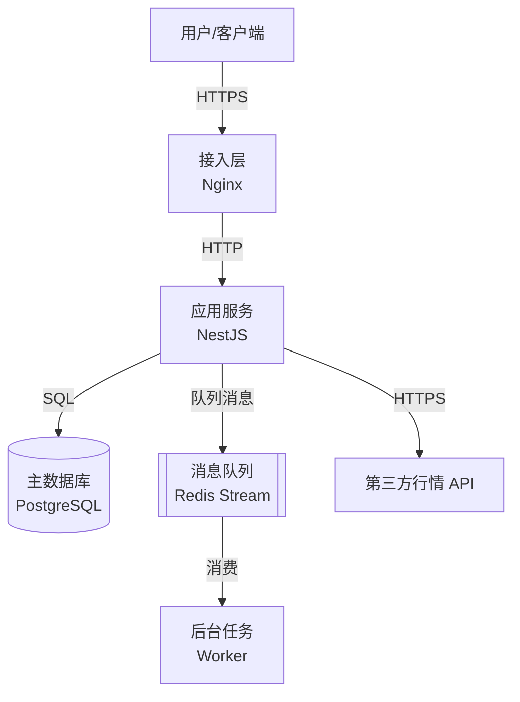
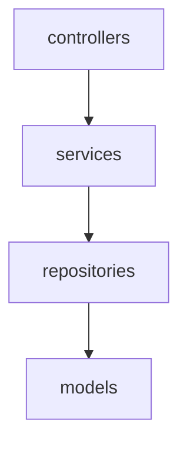

# 系统架构

## 定位与触发条件

**回答的唯一问句**：请求从进入系统到落库，经过了哪些进程与外部系统？

**触发条件**：需要部署运行的项目必选。纯本地脚本、一次性分析脚本可跳过。

**落地位置**：`docs/02-Architecture/系统架构.md`（该目录的固定入口）。

## 可直接使用的 Prompt

```text
你是系统架构师。请为本项目生成「系统架构图」，只回答一个问题：
请求从进入系统到落库，经过了哪些进程与外部系统？

输入：先读启动入口（package.json 的 scripts / pyproject.toml / main 入口文件）、
Dockerfile、docker-compose.yml、部署配置，以及现有的 docs/02-Architecture/系统架构.md。

规则：
1. 只有「独立进程」「独立部署单元」「外部系统」三类可以成为节点。
   同一进程内的控制器、服务、仓储必须合并进一个 subgraph，不许单独成节点。
2. 节点数 ≤15，系统边界（subgraph）≤7。超了就沿主调用链裁剪。
3. 每条边标注传输方式：HTTP、gRPC、SQL、队列消息、文件。
4. 用户与外部第三方要能一眼区分——用不同形状，不要靠颜色。
5. 只输出一张 mermaid graph TD，中文节点名，不加前言与解释。

完成后自检：随便挑一个节点，你能不能说出「为什么它是独立节点」？
说不出来，说明它是模块而不是进程，应当合并进 subgraph。
```

## 结构化指令

### 目标

画出**运行时拓扑**：什么在跑、跑在哪、彼此怎么通信。

### 开始前必读

- 启动入口：`package.json` scripts / `pyproject.toml` / `main.py` / `cmd/`
- 部署形态：`Dockerfile`、`docker-compose.yml`、`Procfile`、systemd unit、计划任务
- 外部依赖：环境变量里的连接串（DB、缓存、对象存储、第三方 API Key）

### 生成步骤

1. **穷举**：列出所有能独立启动的东西（进程、容器、定时任务）和所有外部服务。
2. **剪枝**（质量关键）：
   - 同一容器内的模块 → 合并成一个 `subgraph`
   - 纯函数库、工具包 → 不画
   - 开发期才用的工具（Adminer、Mailhog）→ 移到 `design/` 的环境图，不进主图
   - 超过 15 个节点时，保留"用户 → 入口 → 核心服务 → 存储"主干
3. **定方向**：主数据流自上而下（`graph TD`）。
4. **定边语义**：每条边必须有协议或数据形式。

### 必须包含 / 禁止

- 必须：外部系统（数据库、队列、对象存储、第三方 API）单独成节点——它们才是风险来源
- 必须：批量任务、定时任务与请求链路区分开（虚线或独立分支）
- 必须：每条边标传输方式
- 禁止：把 `src/` 目录结构搬成节点
- 禁止：画数据库表、类、字段
- 禁止：用颜色传达信息（导出图片后颜色语义可能丢失）

### 输出规格

| 项 | 约定 |
|---|---|
| 方向 | `graph TD` |
| 节点命名 | `<角色><br/>技术>`，如 `应用服务<br/>NestJS` |
| 进程分组 | `subgraph` 表示同一部署单元 |
| 外部系统 | 圆角或圆柱形，与自有服务区分 |
| 节点上限 | ≤15 节点 / ≤7 边界 |

## 最小骨架



## 反例



错在哪：

1. **节点是代码目录，不是运行单元**——一个进程被切成四块，看不出「哪个要扩容」「哪个挂了会 502」。
2. **没有外部系统**——数据库、队列、第三方 API 缺席，而架构风险恰恰集中在这些跨边界跳上。
3. **无法回答运维问题**——拿这张图查"超时发生在哪一跳"或"部署顺序是什么"，一句都答不上。

## 自检清单

- [ ] 每个节点都能回答"为什么它是独立节点"（独立进程 / 独立部署 / 外部系统）
- [ ] 数据库、队列、第三方 API 都已作为独立节点出现
- [ ] 每条边都写了传输方式，没有裸箭头
- [ ] 节点 ≤15，边界 ≤7；`src/` 下的目录名一处都没出现
