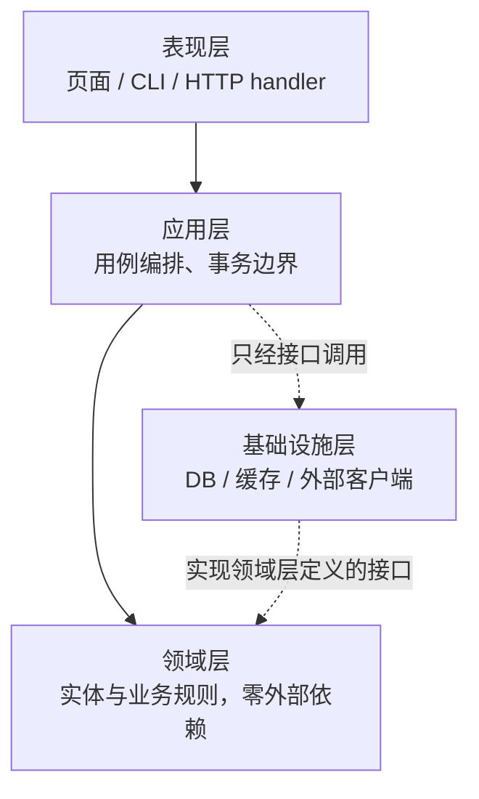
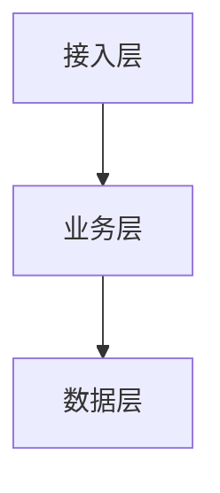

# 技术架构

## 定位与触发条件

**回答的唯一问句**：代码按什么分层，层与层之间只允许朝哪个方向依赖？

**触发条件**：有 2 层以上分层、且团队 ≥2 人的项目才画。单人脚本或单文件项目跳过——分层规范对它们只是形式主义。

**落地位置**：`docs/02-Architecture/tech-arch.md` 或 `docs/02-Architecture/design/技术架构.md`。若不是多进程系统，也可并入 `系统架构.md` 的「分层」小节。

## 可直接使用的 Prompt

```text
你是技术架构师。请为本项目生成「技术架构图」，只回答一个问题：
代码按什么分层，层与层之间只允许朝哪个方向依赖？

输入：先读目录结构（src/ 下的一级目录及其职责）、import 关系、路径别名配置
（tsconfig paths / pyproject 的包划分），以及现有 系统架构.md。

规则：
1. 只画「有独立职责边界的层」，层的数量控制在 3–5。一层一个节点。
   同一个层的多个模块用一句话写进节点名，不许每个模块画成一个节点。
2. 每条箭头都必须带依赖含义（调用 / 实现接口 / 依赖倒置）。
   双向箭头一律不许出现——双向意味着分层失败，要改到单向。
3. 违反本规范的依赖必须显式画出并标红说明，例如「应用层直连 ORM」。
4. 图中不得出现业务功能名（订单、菜单、持仓这类词一律不出现）。
5. 只输出一张 mermaid graph TD，中文层名，不加前言与解释。

完成后自检：如果明天新增一个「支付渠道」，按这张图能不能判断新代码该放哪层？
判断不出来，说明层名写得太笼统，要改成按职责命名而不是按目录命名。
```

## 结构化指令

### 目标

画出**分层与依赖方向**。它回答"代码该放哪"，不回答"系统怎么跑"。

### 开始前必读

- `src/` 一级目录及各自 README 或入口文件
- 路径别名（`tsconfig.json` paths、`pyproject.toml` 的 packages）
- 现有 import 关系中是否存在逆向依赖（领域层反向 import 基础设施层）

### 生成步骤

1. **穷举**：列出代码里所有一级目录。
2. **剪枝**（质量关键）：
   - 按目录合并成 3–5 层，层名用**职责**（表现层、应用层、领域层、基础设施层），不用目录名（`controllers`、`services`）
   - 横切能力（日志、鉴权、配置）→ 单独标为"横切"，用虚线框而非层
   - 只有一两个文件的"层"不算层，并入相邻层
3. **定方向**：依赖只能自上而下；基础设施层通过接口回插（依赖倒置用虚线）。
4. **标异常**：项目里已经存在的跨层直连要画出来，不要隐藏。

### 必须包含 / 禁止

- 必须：每层写清"负责什么"和"不负责什么"
- 必须：标出依赖倒置点（哪个接口由哪层实现）
- 必须：若存在违规依赖，显式画出并注明
- 禁止：出现业务功能名——那属于功能架构
- 禁止：与系统架构同构（见反例）
- 禁止：双向箭头

### 输出规格

| 项 | 约定 |
|---|---|
| 方向 | `graph TD`，依赖自上而下 |
| 节点命名 | `<层名><br/><该层的目录或代表技术>` |
| 层数 | 3–5 |
| 违规依赖 | 虚线 + 注释说明 |

## 最小骨架



## 反例



错在哪：

1. **与系统架构一一对应**——系统架构里的"接入层 / 应用服务 / 数据库"换成"接入层 / 业务层 / 数据层"就是这张图，两张图没提供任何新信息，日后必然打架。
2. **没有依赖约束**——图上只有一条单向链，读者看不出"应用层能不能直接写 SQL"这种真正会引发争论的问题。
3. **没有归类依据**——不给新增功能定位置，新人写完发现被 review 打回，因为图上查不到"支付适配器放哪层"。

## 自检清单

- [ ] 层数在 3–5 之间，每层按职责命名而非按目录命名
- [ ] 全图无双向箭头，无孤岛节点
- [ ] 有一个明确的依赖倒置点（基础设施实现领域接口）
- [ ] 图中任何业务功能名（订单、菜单、持仓……）都未出现
