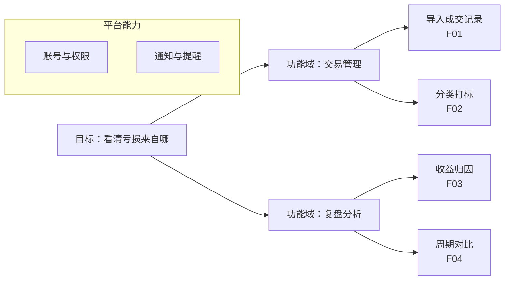

# 功能架构

## 定位与触发条件

**回答的唯一问句**：用户要达成哪几类目标，每类目标由哪些功能项承载？

**触发条件**：功能域 ≥3 时才画。只有一两个功能的小工具不需要——直接看开发计划就够。

**落地位置**：`docs/01-Requirements/PRD-F<nn>-<功能名>.md` 的「功能域」小节，**不单独成文件**。图的叶子编号必须与 `docs/07-MVP/开发计划.md` 的 `F<nn>` 一致。

## 可直接使用的 Prompt

```text
你是产品分析师。请为本项目生成「功能架构图」，只回答一个问题：
用户要达成哪几类目标，每类目标由哪些功能项承载？

输入：先读 docs/01-Requirements/ 下全部 PRD 的「目标」与「范围」，
再读 docs/07-MVP/开发计划.md 的功能编号（F01、F02……）。

规则：
1. 固定三层：用户目标 → 功能域 → 功能项。缺任何一层即重做。
2. 功能域 3–7 个，功能项总数 ≤12。超了就合并同质功能，或把次要目标砍掉。
3. 登录、注册、设置、通知、权限这类横切能力统一归入「平台能力」，
   不占功能域名额，也不与业务目标连线。
4. 每个功能项节点末尾标注 F 编号，必须与开发计划一一对应；
   对不上的功能项要么补 PRD，要么从图中删掉。
5. 只输出一张 mermaid graph LR，中文节点名，不加前言与解释。

完成后自检：任取一条从目标到功能项的路径，能不能读成一句话
「为了<目标>，提供<功能项>」？读不通就是层级搭错了。
```

## 结构化指令

### 目标

画出**目标—能力—功能的支撑关系**，让"这个功能为什么存在"在图上可查。

### 开始前必读

- `01-Requirements/` 下所有 PRD 的「目标」「范围」
- `07-MVP/开发计划.md` 的 `F<nn>` 编号
- 若已有系统架构：确认功能项不与模块名混淆（功能是"用户能做什么"，模块是"代码长什么样"）

### 生成步骤

1. **穷举**：从 PRD 抄出所有功能条目。
2. **剪枝**（质量关键）：
   - 横切能力（登录、设置、通知、权限、日志）→ 收进「平台能力」，不连任何目标
   - 实现细节（字段校验、分页、导出格式）→ 不算功能项
   - 功能域超过 7 个 → 合并同质域（"导入"与"导出"可合为"数据流转"）
   - 功能项超过 12 个 → 下钻成 PRD 的「接缝」，主图只留叶子
3. **定编号**：每个叶子挂 `F<nn>`，与开发计划对齐。
4. **定方向**：目标在左，功能域居中，功能项在右（`graph LR`）。

### 必须包含 / 禁止

- 必须：三层结构完整，不存在跨层直连（目标不能直接连功能项）
- 必须：每个叶子有 F 编号
- 必须：平台能力单独成组
- 禁止：平铺成功能清单
- 禁止：出现技术名词（API、数据库、队列）
- 禁止：叶子无编号、或编号与开发计划对不上

### 输出规格

| 项 | 约定 |
|---|---|
| 方向 | `graph LR` |
| 节点命名 | `功能域：<名>` / `<功能项><br/>F<nn>` |
| 功能域 | 3–7 |
| 功能项 | ≤12 |
| 平台能力 | 独立 `subgraph`，另一端留空 |

## 最小骨架



## 反例


错在哪：

1. **没有目标层**——八个框平铺，读者无法判断"这些功能共同服务于什么"，需求评审时无法据此砍功能。
2. **混入实现细节**——分页、排序是交互手段而非用户能力，它们占位会让真正的功能域看不见。
3. **没有编号**——无法与开发计划、PRD、commit 对上，图在写完当天就过期。

## 自检清单

- [ ] 三层齐全，目标层与功能项层之间不存在直接连线
- [ ] 功能域 3–7 个，功能项 ≤12 个
- [ ] 每个叶子都有 `F<nn>`，且能在开发计划里搜到
- [ ] 平台能力独立成组，未占功能域名额
