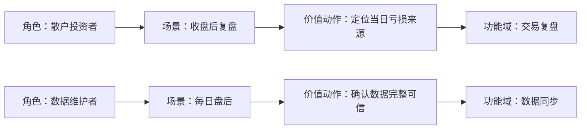
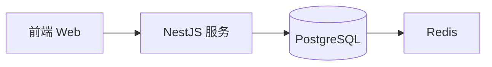

# 产品架构

## 定位与触发条件

**回答的唯一问句**：谁在什么场景下、通过哪条价值流获得什么，由哪个功能域承接？

**触发条件**：有**外部真实用户**的产品才画。内部工具、纯数据管道、SDK/库一律跳过——它们的"用户"是程序员，画出来只是自欺欺人。

**落地位置**：`docs/09-参考资料/产品架构.md`（产品型项目）。它属于产品层，不属于工程层，所以不进 `02-Architecture/`。

## 可直接使用的 Prompt

```text
你是产品经理。请为本项目生成「产品架构图」，只回答一个问题：
谁在什么场景下、通过哪条价值流获得什么，由哪个功能域承接？

输入：先读 docs/01-Requirements/ 的「目标」，用户画像或访谈记录，
以及 docs/09-参考资料/ 里的竞品分析。

规则：
1. 图中的元素只能来自四类：角色、场景、价值动作、功能域。
   四类的形状必须不同，且全图每类至少出现一次。
2. 任何技术名词（数据库、缓存、框架、中间件、协议）一旦出现即为错误，
   必须删除——这张图给业务方看，不是给运维看。
3. 每条价值流写成一个用户能说出口的动宾短语（"快速定位亏损来源"），
   不写系统行为（"调用归因接口"）。
4. 角色 ≤5 个，场景每角色 ≤3 个，功能域 ≤7 个。
5. 只输出一张 mermaid graph LR，中文节点名，不加前言与解释。

完成后自检：把图发给一个不懂技术的业务同事，他能不能说出
「谁在什么时候用、用来干嘛」？说不出来就是没画出价值流。
```

## 结构化指令

### 目标

画出**价值如何从角色流到功能**。它是需求取舍的依据：没有价值流承接的功能域可以直接砍。

### 开始前必读

- PRD 的「目标」与「不包含」
- 用户画像、访谈、客服记录（真实场景，不是想象场景）
- `09-参考资料/` 的竞品，用于确认哪些场景是行业标配

### 生成步骤

1. **穷举**：列出所有角色（含非付费角色：运营、审核、数据维护者）。
2. **剪枝**（质量关键）：
   - 角色超过 5 个 → 只保留"会直接使用产品"的，内部角色合并
   - 场景必须是**有触发时点**的（"每天收盘后""接到异常告警时"），没有触发时点的是伪场景，删掉
   - 价值动作必须让角色自己获益，若只是"便于系统统计"，删掉
   - 技术组件一律删除（这是本视图最高频的错误）
3. **串联**：角色 → 场景 → 价值动作 → 承接它的功能域。
4. **校验**：每个功能域必须至少被一条价值流指向；没人指向的功能域标记为"待验证"。

### 必须包含 / 禁止

- 必须：四类元素齐全，形状可区分
- 必须：每个场景有触发时点
- 必须：每个功能域至少有一条价值流承接
- 禁止：出现任何技术名词
- 禁止：出现"系统""平台""后台"这类无角色主体
- 禁止：脱离 PRD 凭空构造场景

### 输出规格

| 项 | 约定 |
|---|---|
| 方向 | `graph LR` |
| 角色 | `角色：<名>` |
| 场景 | `场景：<时点 + 情况>` |
| 价值动作 | 动宾短语，第三人称可读 |
| 功能域 | `功能域：<名>`，与功能架构保持一致 |

## 最小骨架



## 反例



错在哪：

1. **把部署图当产品架构**——图上没有一个真实角色，全是技术组件，业务方看完不知道这产品对谁有用。
2. **没有价值流**——说不出"哪一步让用户受益"，所有功能都成了合理功能，需求评审时无法砍掉任何一个。
3. **无法映射到 PRD**——功能域与图中的组件对不上，PRD 里的目标在架构上没有托底。

## 自检清单

- [ ] 全图零技术名词，零"系统/平台"这类无主体描述
- [ ] 每个场景都有明确触发时点，不是泛泛的"日常使用"
- [ ] 每条价值流读起来是用户的话，不是系统的行为
- [ ] 每个功能域都被至少一条价值流指向，且名称与功能架构一致
