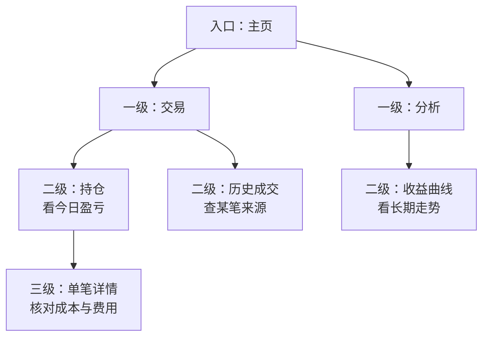
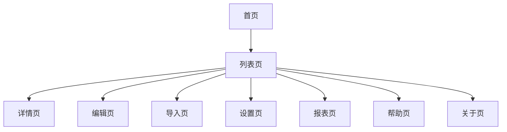

# 信息架构

## 定位与触发条件

**回答的唯一问句**：用户要找的内容或功能，按什么层级组织，从哪进、到哪出？

**触发条件**：页面 ≥5 个，或导航层级 ≥3 级时才画。单页应用、单窗口 CLI 跳过。

**落地位置**：`docs/02-Architecture/design/信息架构.md`。

## 可直接使用的 Prompt

```text
你是交互设计师。请为本项目生成「信息架构图」，只回答一个问题：
用户要找的内容或功能，按什么层级组织，从哪进、到哪出？

输入：先读路由表（routes / router 配置）、页面清单、菜单或导航配置。

规则：
1. 层级深度不超过 3 级。超过 3 级的必须提出替代方案（聚合页、搜索、tab）。
2. 同一级下的条目 ≤7 个，超过就分组——这是导航可扫读的上限，不是审美偏好。
3. 每个叶子节点必须写两行：名称 + 「给谁解决什么」。
   写不出第二行的页面，标记为待删除候选。
4. 必须标出入口（用户从哪进来：首页、通知、外部链接）和
   出口（完成后去哪：列表、详情、下一步动作）。
5. 同一个页面在图里只能出现一次。需要多处入口的，用虚线从入口指向它。
6. 只输出一张 mermaid graph TD，中文节点名，不加前言与解释。

完成后自检：找一个具体任务（比如「改一笔分类」），
能不能只看这张图走完全程、不回头、不迷路？走不通就是层级有问题。
```

## 结构化指令

### 目标

画出**导航层级与页面归属**，让"某个功能该挂哪个菜单"有唯一答案。

### 开始前必读

- 路由表（`router.ts`、`app/` 目录、`pages/` 目录）
- 导航菜单配置
- 若已有功能架构：确认每个功能项都能落到某个页面上

### 生成步骤

1. **穷举**：列出所有页面与所有可导航视图。
2. **剪枝**（质量关键）：
   - 弹窗、抽屉、确认框 → 不算独立层级，挂在宿主页面后作为注解
   - 同一页面的不同 tab → 合并成一个节点，在节点名里注明 tab
   - 超过 3 级的路径 → 必须重构（聚合页 / 全局搜索 / 横向 tab），而不是照实画出 5 级
   - 写不出"给谁解决什么"的页面 → 标为待删除候选
3. **定排序**：同级条目按使用频率或任务流排序，不是按字母或开发顺序。
4. **标出入口**：首页 / 通知 / 深链是入口；任务完成后的落点是出口。

### 必须包含 / 禁止

- 必须：深度 ≤3、同级 ≤7
- 必须：每个叶子写"给谁解决什么"
- 必须：标出入口与出口
- 禁止：页面名重复出现（需要多入口时用虚线引用）
- 禁止：画后端服务、接口、数据库
- 禁止：把弹窗画成独立层级

### 输出规格

| 项 | 约定 |
|---|---|
| 方向 | `graph TD` |
| 节点命名 | `一级：<名>` / `二级：<名><br/><用途>` |
| 深度 | ≤3 |
| 同级条目 | ≤7 |
| 多入口 | 虚线指向，节点不重复 |

## 最小骨架



## 反例



错在哪：

1. **退化成站点地图**——只画了页面之间的跳转，没有任何"组织依据"，读者不知道这些页面为什么平级、为什么挂在列表页下。
2. **同级 8 个且无分组**——超过 7 个后导航失去可扫读性，但图上看不出该合并哪几个。
3. **叶子没有用途说明**——"编辑页"是编辑什么的？读者必须去翻代码才能知道，图等于没画。

## 自检清单

- [ ] 深度 ≤3，同级条目 ≤7，`subgraph` 表示分组
- [ ] 每个叶子都有"给谁解决什么"，没有例外
- [ ] 没有页面重复出现；多入口用虚线引用
- [ ] 任取一个用户任务，能沿图走完全程并看到终点
