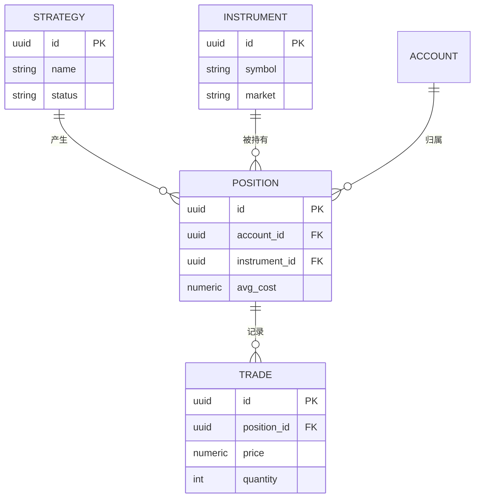
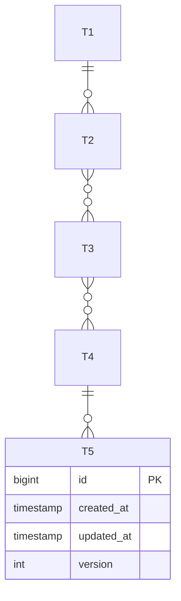

# ER

## 定位与触发条件

**回答的唯一问句**：系统有哪些核心实体，它们靠什么关系串起来？

**触发条件**：有持久化数据库即需要。无数据库项目（纯文件、纯 API 代理）跳过。

**落地位置**：`docs/03-Database/数据库设计.md` 的「ER 图」小节。字段级说明归 `数据字典.md`，不在这张图里。

## 可直接使用的 Prompt

```text
你是数据建模师。请为本项目生成「ER 图」，只回答一个问题：
系统有哪些核心实体，它们靠什么关系串起来？

输入：先读 schema.prisma、migrations、或现有 数据库设计.md 的表清单。

规则：
1. 先剪枝：只保留被 3 张以上表引用的实体作为主干，主干实体 ≤7 个。
   其余实体视情况再补，全图实体总数 ≤12。
2. 关联表（多对多的中间表）不画成实体，直接表达为多对多关系；
   若中间表自身带有业务含义（如「订单明细」带价格与数量），才升级为实体。
3. 每个实体只保留三类字段：主键、外键、1–3 个决定「它是什么」的字段。
   索引、字段类型、created_at / updated_at / deleted_at 等审计字段一律不画。
4. 每条关系必须标基数（||--o{ / }o--|| / }o--||）。
   关系标签用中文动宾短语：包含、属于、触发、引用。
5. 超过 12 个实体时，按领域拆成多张图（交易域、账户域、行情域），
   每张图用 subgraph 标出领域边界。
6. 只输出 mermaid erDiagram，实体名用表原名（英文），不加前言与解释。

完成后自检：拿这张图去问业务方「这个系统的主语是什么」，
他能不能指着某几个实体答出来？答不出来就是主干选错了。
```

## 结构化指令

### 目标

画出**实体关系骨架**，让人在 30 秒内理解业务的数据主谓宾。

### 开始前必读

- `schema.prisma` / `migrations/*.sql` / 建模文档
- 现有 `数据库设计.md` 与 `数据字典.md`（避免重复劳动）
- 外键关系：以"这个表被谁引用"而不是"这个表引用了谁"来判主干

### 生成步骤

1. **穷举**：列出全部表。
2. **剪枝**（质量关键）：
   - 记录被引用次数，取前 5–7 个为主干
   - 日志表、审计表、临时表、统计汇总表 → 不画（它们是派生数据，不是业务实体）
   - 纯关联表 → 关系线，不画实体
   - 其余实体按需二阶展开，总数守住 12
3. **定关系**：逐个确认基数。绝大多数"看起来是多对多"其实是"一对多 + 中间实体"。
4. **定字段**：每个实体只留 PK、FK 与判定性字段。
5. **拆域**：超过 12 个实体必须拆图，不要靠缩小字号硬塞。

### 必须包含 / 禁止

- 必须：每条关系标基数
- 必须：主干实体 ≤7，总实体 ≤12
- 必须：一对多的"多"侧在外键上可反推
- 禁止：画索引、索引类型、字段长度
- 禁止：画审计字段（`created_at`、`updated_at`、`deleted_at`）
- 禁止：多对多直连却实际存在业务属性（应当升级为实体）
- 禁止：一张图塞全库

### 输出规格

| 项 | 约定 |
|---|---|
| 语法 | `erDiagram` |
| 实体名 | 表原名（英文，不改写为中文） |
| 关系标签 | 中文动宾短语（包含 / 属于 / 触发） |
| 实体上限 | 主干 ≤7，总数 ≤12 |
| 领域边界 | `erDiagram` 内用注释或拆图表达 |

## 最小骨架



## 反例



错在哪：

1. **全库塞一张**——三十张表挤在一张图里，关系线互相交叉，读者只能放弃阅读，退回去看 schema。
2. **多对多直连**——`}o--o{` 抹掉了关系上的业务属性（谁下的单、什么价格），而真实模型里这些属性恰恰是核心。
3. **画了审计字段**——`created_at`、`version` 占满字段区，把真正的判定性字段（金额、状态）挤没了。

## 自检清单

- [ ] 主干实体 ≤7，总数 ≤12；超了已按领域拆图
- [ ] 每条关系都有基数与中文标签
- [ ] 每个实体只保留 PK / FK / 判定性字段，无审计字段
- [ ] 关联表已降级为关系线，或已因业务属性升级为实体
